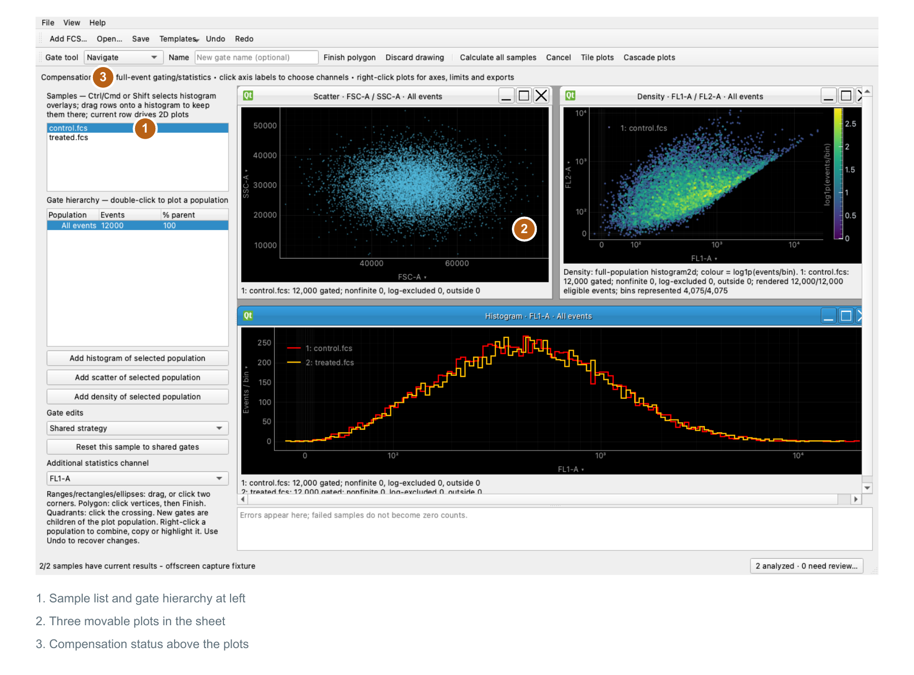

# FlowHero

Free desktop program for flow cytometry analysis: load FCS files, draw hierarchical gates on a movable plot sheet, compare samples in overlaid histograms, and export statistics for Prism, Excel, R or Python. Runs locally on Windows, macOS and Linux. The FCS reading, compensation and gate evaluation are done by [FlowKit](https://github.com/whitews/flowkit).



**Status: development version 0.10.2.** The calculations are covered by 264 automated tests that compare counts and statistics with independent NumPy calculations. FlowHero has not yet been compared systematically with other analysis programs on real experiments, and it has not been run on Windows. Check your results against an established program before publishing them. Details: [validation status](docs/VALIDATION.md).

## What it does

| | |
|---|---|
| Plots | Scatter, density and histogram plots on one sheet; linear, log and logicle axes |
| Gates | Rectangle, polygon, ellipse, range, quadrant; combined gates (AND, OR, NOT); one shared strategy with per-sample adjustments |
| Compensation | Off, from each file's spillover matrix, or one matrix for all samples |
| Comparison | Overlaid or offset histograms of any number of samples; drag samples onto a histogram |
| Statistics | Counts, percentages, median, mean, geometric mean, SD, CV, robust CV, percentiles, events per µL; always from every event and untransformed values |
| Exports | Statistics tables (long or wide) with a provenance file, methods report, plot images (PNG, SVG, PDF), events, histogram bins |
| Exchange | Gates from Gating-ML 2.0 and from FlowJo 10 workspaces (`.wsp`); gate export as Gating-ML; portable project packages |
| Safety | Undo/redo, recovery copy of unsaved work, original FCS files are never modified |

Not included: calculating a compensation matrix from single-stain controls, spectral unmixing, FlowJo's biex axis (such gates are converted to logicle on import), clustering, dimensionality reduction and plate layouts.

## Install and start

You need Python 3.10, 3.11 or 3.12 ([python.org](https://www.python.org/downloads/); on Windows tick "Add python.exe to PATH") and an internet connection for the first start.

1. Download this repository (Code > Download ZIP) and unpack it on your computer, not on a network drive.
2. Start it:
   - **Windows:** double-click `start_flowhero.bat`
   - **macOS:** double-click `start_flowhero.command` (the first time: right-click > Open)
   - **Linux:** `bash start_flowhero.command`

The first start creates a folder `.venv` inside the FlowHero folder and downloads the packages into it. This takes a few minutes and several hundred MB; nothing is installed outside the folder. To remove FlowHero, delete the folder.

By hand, on any system:

```bash
python -m venv .venv
.venv/bin/python -m pip install -e .        # Windows: .venv\Scripts\python
.venv/bin/python -m flowhero
```

## First steps

1. File > Open portable package… and choose `examples/first-analysis.flowhero.zip`. It is a small synthetic experiment with gates.
2. Or click Add FCS and load your own files. Right-click a plot to change its type, channels and population; choose a gate tool and draw.
3. File > Export > Statistics writes the table.

The [user manual](docs/MANUAL.md) goes through every function with pictures. Definitions of scales, compensation, gates and statistics are in [analysis options](docs/ANALYSIS_OPTIONS.md) and [exports](docs/EXPORTS.md). Further documents: [gate import](docs/GATE_IMPORT.md), [projects and portable packages](docs/PORTABLE_PROJECTS.md), [program structure](docs/ARCHITECTURE.md), [changelog](CHANGELOG.md).

## Scientific scope

Values are read as FlowKit delivers them after acquisition preprocessing. They are uncompensated unless compensation is switched on; every export states which. Gates are evaluated by FlowKit in the coordinates they were drawn in (linear, log10 or logicle). Statistics always use every event of a population and untransformed values; plots may show a subset of points.

The singlet gate proposal, the time-course flag and the experimental adaptive gate proposals (`flowhero analyze`) are aids with stated formulas. They have not been validated on real acquisitions; review every proposal.

## Command line

```bash
flowhero inspect PROJECT
flowhero export-statistics PROJECT --output table.csv [--layout wide] [--channel NAME] [--statistic sd]
flowhero methods-report PROJECT --output record.md
```

## Run the tests

```bash
.venv/bin/python -m pip install -e . pytest
QT_QPA_PLATFORM=offscreen .venv/bin/python -m pytest -q
```

## Cite

If you use FlowHero, please cite this repository (see [CITATION.cff](CITATION.cff), or "Cite this repository" on GitHub) together with the version number, and cite FlowKit:

> White S, Quinn J, Enzor J, Staats J, Mosier SM, Almarode J, Denny TN, Weinhold KJ, Ferrari G, Chan C. FlowKit: A Python Toolkit for Integrated Manual and Automated Cytometry Analysis Workflows. Front Immunol. 2021;12:768541. doi:10.3389/fimmu.2021.768541

File > Export > Methods report writes the software versions, gate coordinates and statistic definitions of an analysis for a methods section or supplement.

## Authors and licence

Jonathan Held, with the AI coding agents Codex (OpenAI) and Claude (Anthropic); see [AUTHORS.md](AUTHORS.md). FlowHero is personal work and is not affiliated with any employer, institution or cytometry vendor. FlowJo is a trademark of its owner and is named only to describe file compatibility.

Licence: [BSD 3-Clause](LICENSE), the same as FlowKit. FlowHero uses Qt through PySide6 (LGPL); see `packaging/THIRD_PARTY_NOTICES.txt`.

Bug reports and suggestions: please open an issue, see [CONTRIBUTING.md](CONTRIBUTING.md).
