# FlowHero 0.10.2 - user manual
Updated 2026-11-21. The figures are FlowHero windows drawn without a screen on macOS with synthetic data, so window frames and fonts differ slightly from your desktop.

## 1. FlowHero 0.10.2
User manual | Updated 21 November 2026

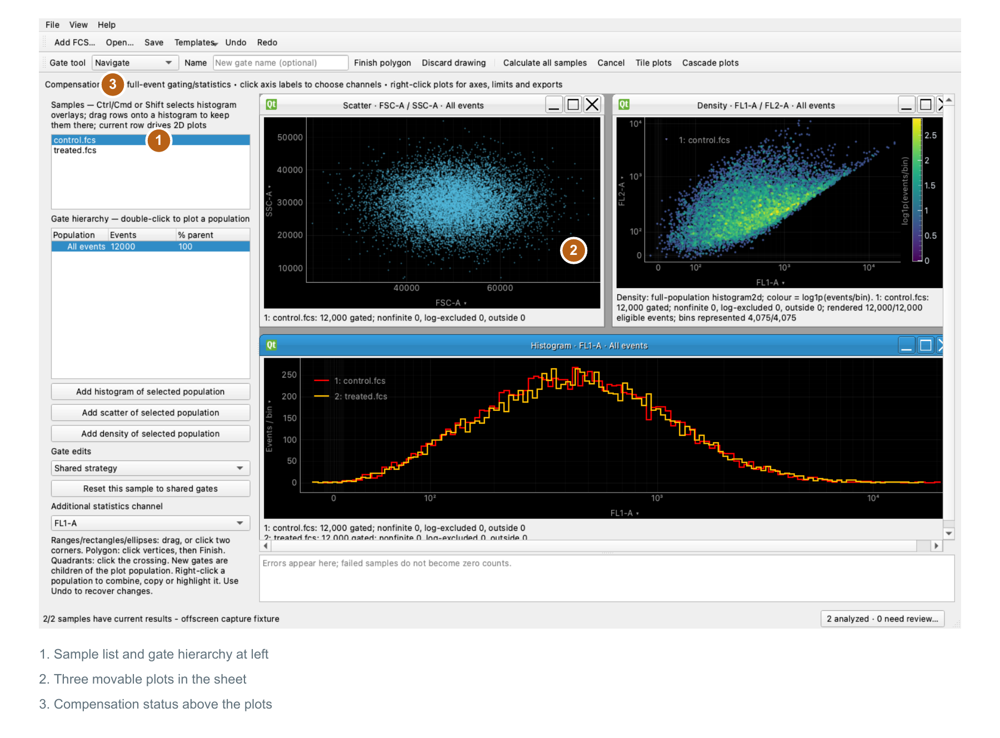

1. For first-time users: follow chapters 3 to 5, then use the reference chapters for your experiment.
2. FlowHero reads FCS acquisitions, builds hierarchical gates and computes statistics from every selected event. Plot rendering may use fewer events.
3. This edition includes the functions introduced up to 0.10.2, plus the FlowHero name, commands and default filenames.

All figures show synthetic data. FlowHero is a development version; see docs/VALIDATION.md for what has been checked.

## 2. Contents
- 3. Install and launch
- 4. Your first analysis
- 5. Import gate definitions
- 6. Load and inspect samples
- 7. Arrange plots and read density
- 8. Axes: linear, log and logicle
- 9. Choose compensation
- 10. Draw and edit gates
- 11. Shared and sample-only geometry
- 12. Combine and copy gates
- 13. Highlight populations across plots
- 14. Compare samples with overlays
- 15. Drag more FCS files onto a histogram
- 16. Keep or change the histogram sample list
- 17. Overlay files without an eight-file limit
- 18. Check the acquisition over time
- 19. Export the statistics you need
- 20. Understand values and statuses
- 21. Histogram snapshots and bin export
- 22. Export events, images and methods
- 23. Annotations and control thresholds
- 24. Save, reopen and relink
- 25. Share a portable package
- 26. Import a FlowJo workspace
- 27. Templates and adaptive proposals
- 28. Recovery and troubleshooting
- 29. Quick reference


## 3. Install and launch
FlowHero needs Python 3.10, 3.11 or 3.12 and an internet connection for the first start.

1. Download the FlowHero folder (on GitHub: Code > Download ZIP, then unpack) to your computer. Do not run it from a network drive.
2. If Python is missing, install it from https://www.python.org/downloads/ (Windows: tick "Add python.exe to PATH" in the installer).
3. Start FlowHero. macOS: double-click `start_flowhero.command` (the first time, right-click > Open). Windows: double-click `start_flowhero.bat`. Linux: `bash start_flowhero.command` in a terminal.
4. The first start creates a folder `.venv` inside the FlowHero folder and downloads FlowKit, Qt and the other packages into it (several hundred MB, a few minutes). Nothing is installed outside the FlowHero folder. Later starts are immediate.

```text
# the same by hand
python -m venv .venv
.venv/bin/python -m pip install -e .          (Windows: .venv\Scripts\python)
.venv/bin/python -m flowhero
```

Package versions are fixed: FlowKit 1.2.3, PySide6 6.10.0, pyqtgraph 0.13.7. To remove FlowHero, delete its folder. No signed standalone app is supplied yet.

## 4. Your first analysis
Use the supplied six-event example before starting a real experiment.

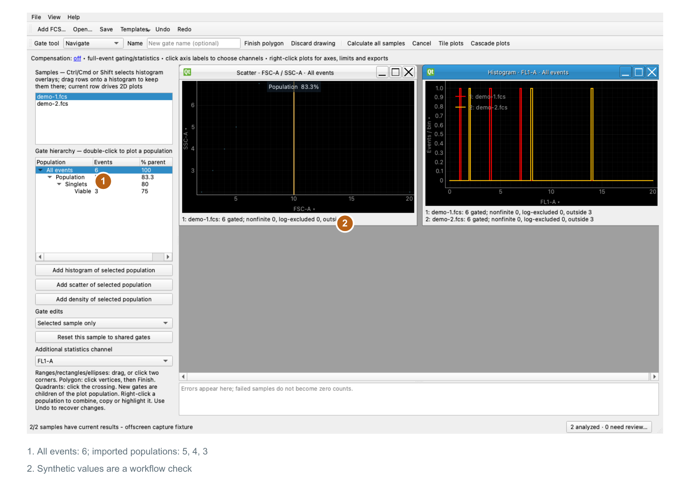

1. Use File > Open portable package to open companion examples/first-analysis.flowhero.zip into a new local folder. It already contains the imported demonstration gates and two synthetic acquisitions.
2. For demo-1, confirm All events = 6, Population = 5, Singlets = 4 and Viable = 3. The hierarchy is parent before child.
3. Choose FL1-A and median. The three viable values in demo-1 are 1, 4 and 7; their median is 4. The second sample doubles the fluorescence values.
4. Save under a new name, reopen, and export statistics. These counts are a deterministic workflow check; they do not establish biological validity.

Use the portable example to reconstruct valid local FCS bindings after moving the manual. Keep its imported folder together.

## 5. Import gate definitions
Import appends new shared gates; it does not replace the existing strategy.

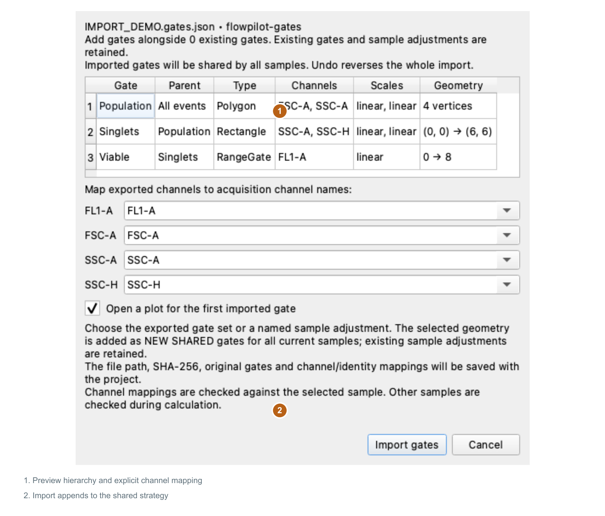

1. Load compatible FCS files, then choose File > Import > Gate definitions. Choose the companion IMPORT_DEMO.gates.json or a supported Gating-ML file.
2. Review names, parents, gate types, geometry and scale interpretation. Map every required channel to an acquisition channel.
3. When the file offers sample geometry variants, select the intended variant explicitly. Foreign sample IDs are not automatically matched to your acquisitions.
4. Confirm Import gates. Inspect the new populations and counts; Undo reverses the import. Unsupported data must be corrected or re-exported rather than guessed.

Gating-ML support is a subset. Combined-gate and named-matrix Gating-ML imports are not supported. An exported file is not necessarily importable when it uses those features.

## 6. Load and inspect samples
Add FCS from the toolbar, File menu or drag and drop. FCS source bytes are not modified.

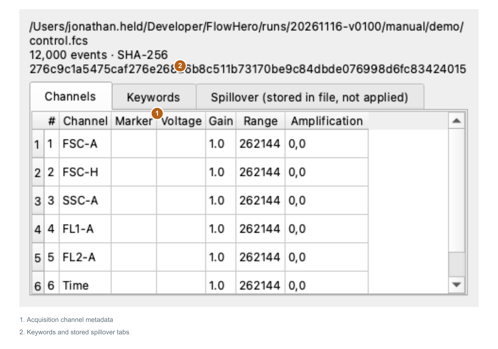

1. The current sample row drives 2D plots. Select several rows with Cmd/Ctrl or Shift for automatic histogram overlays. There is no fixed sample cap. Drag rows onto a histogram to keep its own sample list.
2. Right-click a sample > File information to inspect channels, marker labels, acquisition keywords and a stored spillover matrix.
3. Channel names identify measurements; marker/stain labels help you choose them. Check area versus height channels carefully.
4. Right-click also offers Relink sample and Remove sample from project. Removing a row keeps the original FCS file and supports Undo.

A stored spillover matrix is acquisition metadata. It is applied only when you select a compensation mode that uses it.

## 7. Arrange plots and read density
The plot title states its type, channels and parent population.


1. Select a population in the tree, then add a histogram, scatter or density plot with the buttons below the hierarchy. Double-click a population to plot it.
2. Move or resize plot windows; use Tile plots or Cascade plots to rearrange the sheet. Closing a plot does not remove its gate.
3. Density colour reports events per bin, with sparse points retained and optional contours. Read the colour scale and per-plot exclusion notes.
4. Right-click a plot to change type, population, axis options or exports. View > Show statistics table opens the optional bottom table.
5. Right-click a plot and choose Duplicate plot to create an independent copy with all its settings. Undo removes the copy.

Counts and statistics use the full population even when points are sampled for display. A dense-looking region is not proof that a biological gate is correct.

## 8. Axes: linear, log and logicle
Click an axis label, or right-click a plot to configure it.

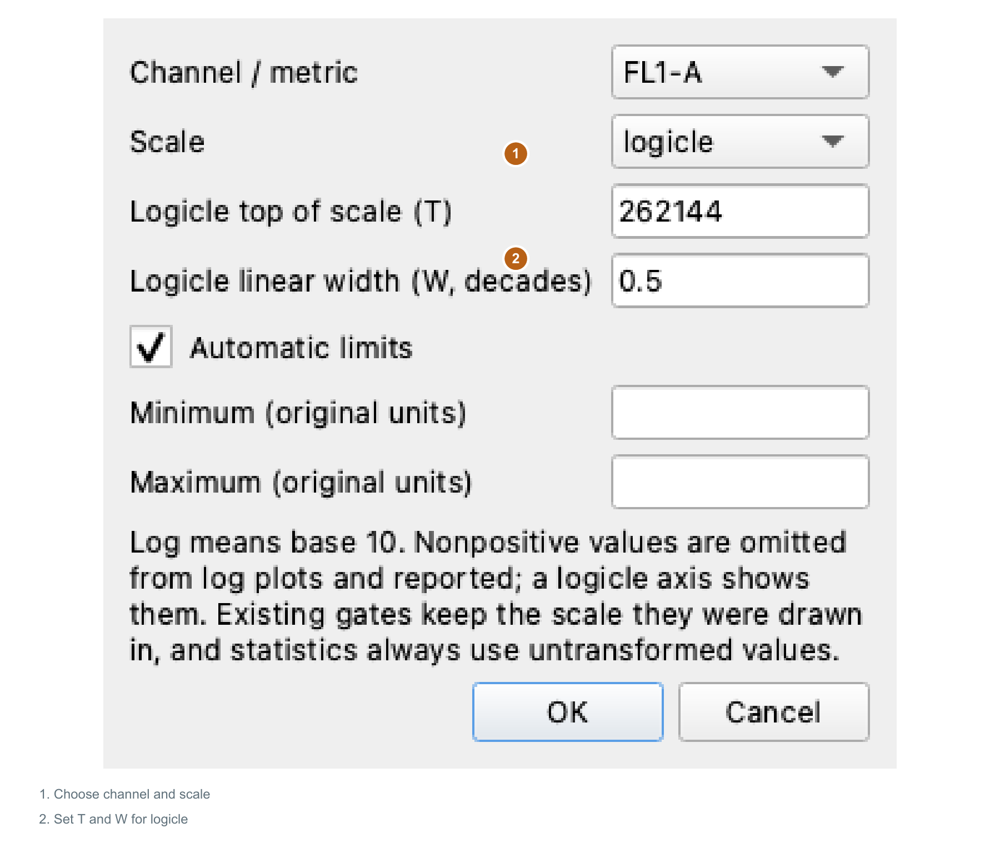

1. Choose the channel, display scale and limits. Linear keeps original coordinates; log uses base 10 and excludes zero/negative values from that view.
2. Logicle shows negative values, zero and positive values. Defaults: T = 262144, W = 0.5, M = 4.5, A = 0. The dialog exposes T and W.
3. A gate stores the scientific coordinate scale on which it was drawn. Its outline is converted for another display scale, but dragging is disabled there.
4. To edit a gate, return the plot to the gate scale. Changing a display scale does not redefine the stored gate. Statistics use values before axis transformation.

On compensated projects, statistics use compensated values before the axis transformation. Review the data domain with every export.

## 9. Choose compensation
Click the underlined setting in the line above the plots.

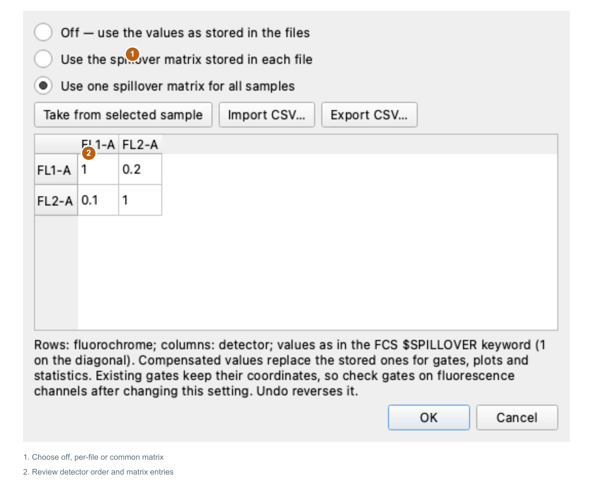

1. Off uses acquisition-preprocessed values. Stored in each file applies that file's matrix; a missing or unreadable matrix reports an error.
2. One matrix for all samples uses the displayed channel order and numbers. Take it from the selected sample, import a CSV, or edit the cells.
3. Rows are fluorochromes and columns are detectors. Scatter/time channels cannot be included. FlowKit applies events multiplied by the inverse spillover matrix.
4. Compensation affects gates, plots, statistics and exports. Existing gates retain their coordinates when compensation changes; inspect every fluorescence gate afterwards. Undo reverses the change.

No compensation estimation from single-stain controls or spectral unmixing is implemented. Adaptive gating refuses compensated projects.

## 10. Draw and edit gates
Choose a Gate tool, enter an optional name and draw on the correct parent plot.

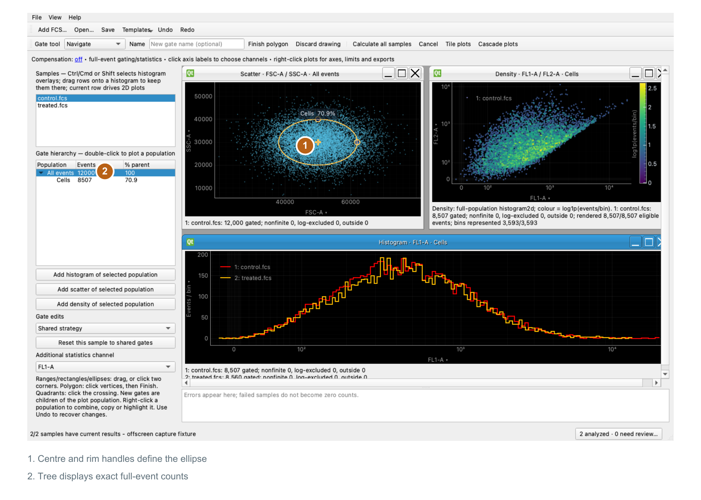

1. Polygon: click corners, then Finish polygon or Return; right-click removes the last corner. Rectangle: drag or click opposite corners.
2. Ellipse: drag a bounding box. Move the centre handle to translate; move either rim handle to resize and tilt. There is no separate rotation handle.
3. Histogram range: drag along a histogram. Quadrants: click the crossing point to make four linked populations.
4. Gate membership includes the parent selection. The tree shows the count and percent of parent. Drag handles to edit, and use Undo/Redo to review changes.

Gate calculations are covered by automated tests; mouse handling is checked by hand only. Open imported rectangles may have read-only outlines. In a fixed histogram, range outlines and edits still follow the selected sample. Select a sample that belongs to that histogram before editing, and check the edit scope.

## 11. Shared and sample-only geometry
Check the Gate edits scope before moving a boundary.

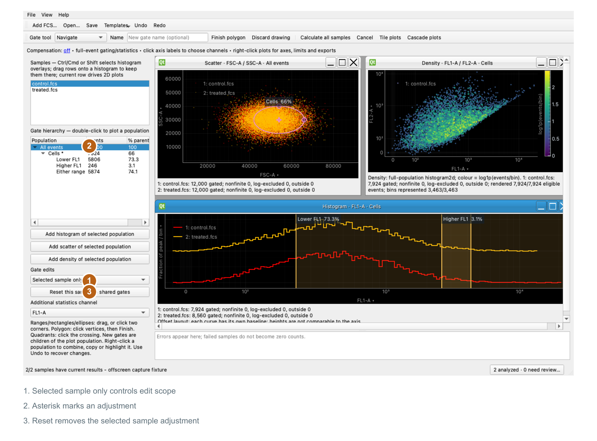

1. Shared strategy edits the reference shape used by compatible samples. Selected sample only stores an effective geometry adjustment for the current sample.
2. An asterisk in the tree marks a sample adjustment. Switch samples to confirm which geometry is effective.
3. Reset this sample to shared gates removes that sample's adjustments. It does not delete the shared strategy.
4. Copy/paste uses shared geometry and descendants; it does not copy sample-specific adjustments. Existing files and sample identities remain separate.

An imported sample-specific variant becomes the chosen shared import geometry. It does not imply automatic correspondence between vendor samples and your FCS files.

## 12. Combine and copy gates
Right-click a gate in the hierarchy for population operations.

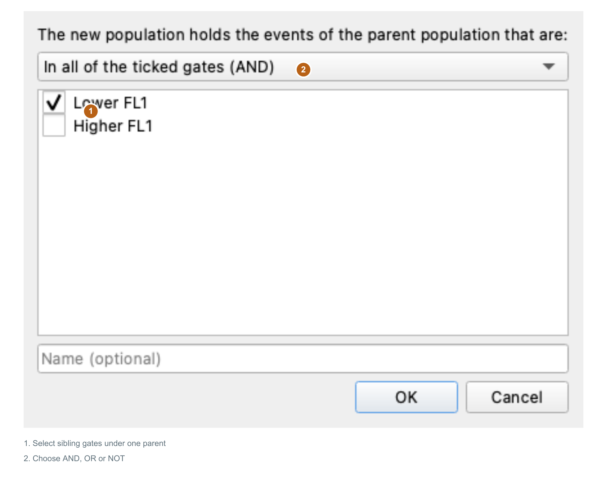

1. Combine gates requires operands under the same parent. AND keeps events in every chosen gate; OR keeps events in any; NOT keeps parent events outside one gate.
2. A combined gate has no geometric outline and no sample-specific position. It follows the effective geometry of its operand gates.
3. Deleting an operand also deletes combined gates that depend on it. Check the affected branch before deleting.
4. Copy gate / Paste gate here copies the shared gate and its descendants under the target population. Four quadrants remain linked only when all four are copied.

The scientific engine checks hierarchy and dependency cycles. Combined gates are not supported by the adaptive-gating workflow.

## 13. Highlight populations across plots
Right-click a gate > Highlight in all plots.

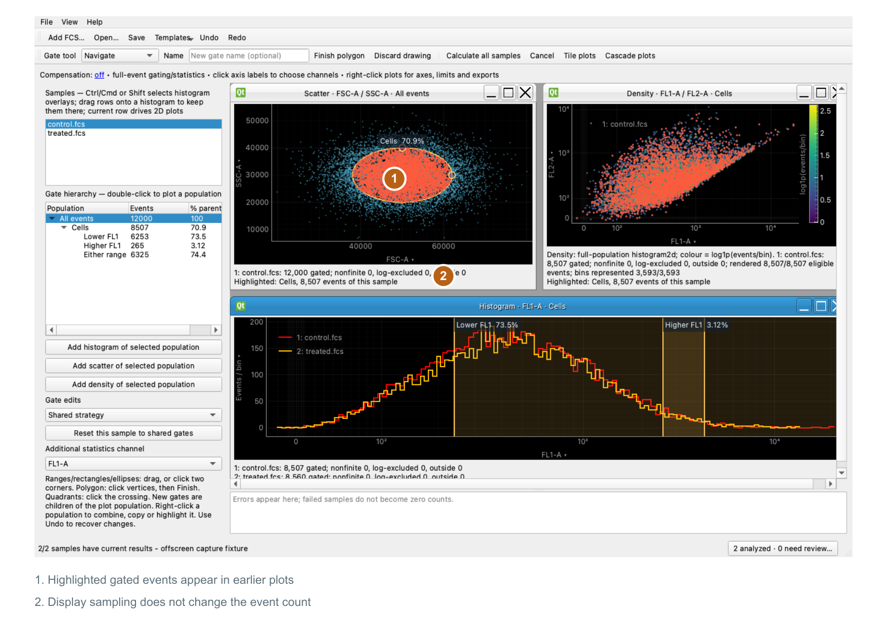

1. The selected population appears in a second colour in every 2D plot of the current sample. Use this to locate it in earlier parent plots.
2. Read the exact highlighted event count in the plot summary. At most 4000 highlighted points per plot are drawn.
3. Press Esc to clear the highlight. Highlighting is display-only and is not saved in the project.
4. Use the gate hierarchy, relevant controls and full-event statistics to interpret a population; backgating is a visual inspection aid.

## 14. Compare samples with overlays
Select multiple sample rows, then configure each plot.

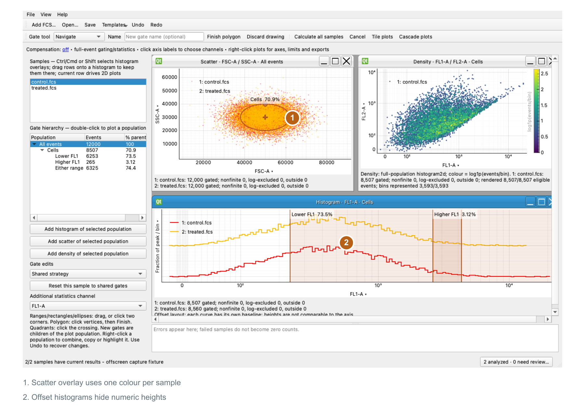

1. Automatic histograms follow selected sample rows. Dragging rows onto a histogram gives that histogram its own fixed list. Count, event-fraction and peak modes change curve heights without changing the population median.
2. Offset overlaid histograms gives each curve its own baseline. Numeric heights are hidden because curve baselines differ.
3. Scatter plots support Overlay selected samples in the context menu, without a fixed sample cap. Common limits are fixed when the overlay starts.
4. Density plots cannot overlay samples. View > Light plot background changes the screen theme; exported images use white backgrounds.

Check legend identities, shared bins, axis scales, normalization and out-of-range counts before comparing distributions.

## 15. Drag more FCS files onto a histogram
Add loaded samples to an existing histogram while keeping its population and gates.

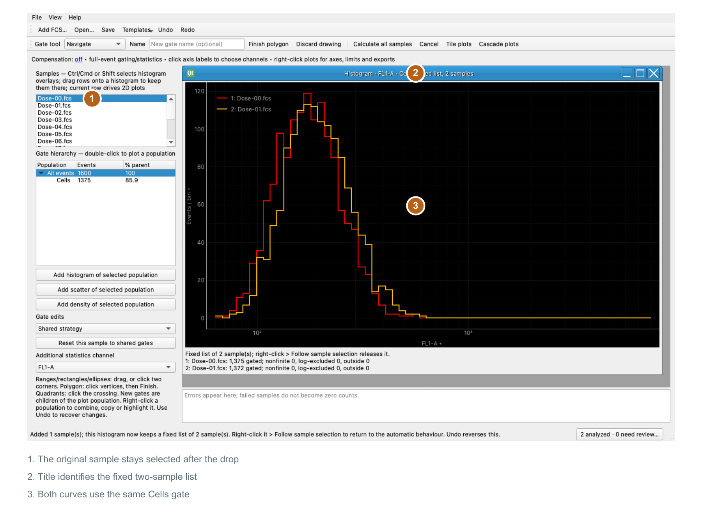

1. Add the FCS acquisitions with Add FCS first. Create a histogram for the desired population and let its initial calculation finish.
2. Drag a sample row straight from the sample list onto that histogram. For several rows, select them with Cmd/Ctrl or Shift and drag the group.
3. The histogram keeps the samples it showed before the drag and adds the dropped samples once each. Only the target histogram gains the files; the sample-list selection is restored after the drop.
4. Read fixed list, N samples in the histogram title. Later sample-list clicks do not replace that fixed list. Re-dropping the same sample does not duplicate it.
5. Each added sample uses the same population and its own effective shared or sample-adjusted gates. The drop does not change compensation, channel, scale, bins or normalization.

The first drop fixes the common X limits. Values outside remain included in full-event statistics and are counted as outside in the plot. Undo reverses a drop.

## 16. Keep or change the histogram sample list
Right-click the histogram to switch between fixed and automatic sample lists.

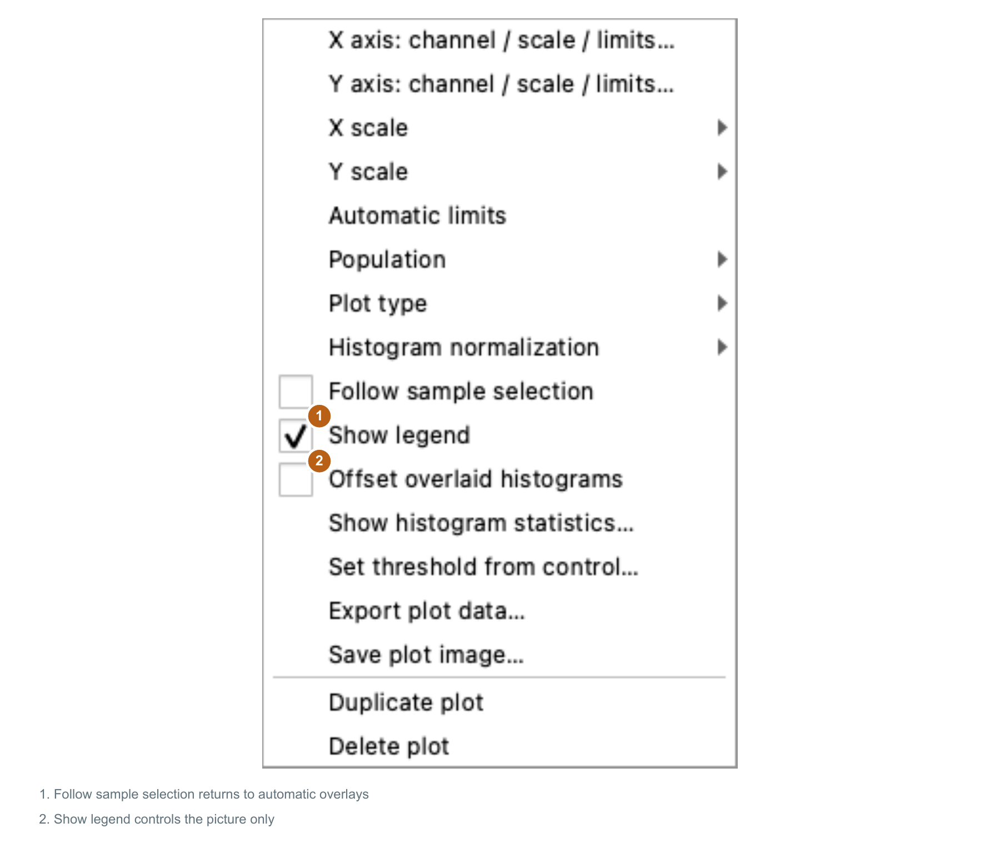

1. Follow sample selection checked: the histogram follows the selected sample rows. Uncheck it to fix what is currently shown, even without a drag.
2. After a drop, Follow sample selection is unchecked. Check it again when you want the current list selection to control this histogram.
3. To replace a fixed list with a smaller subset, select those rows, turn Follow sample selection on, then turn it off to keep the subset. There is no separate per-curve removal command in this release.
4. Show legend hides or shows sample labels only. It does not remove curves, change populations, or reduce the exported statistics and bins.
5. Save/reopen and portable packages retain the fixed list. Removing a sample from the project also removes it from fixed lists. Templates do not carry sample lists.

If the app says to wait until the histogram has been calculated, no samples were added. Let calculation finish and retry. Refused drops are reported as refused.

## 17. Overlay files without an eight-file limit
FlowHero 0.10.0 removed the fixed overlay cap. Every requested sample is retained.

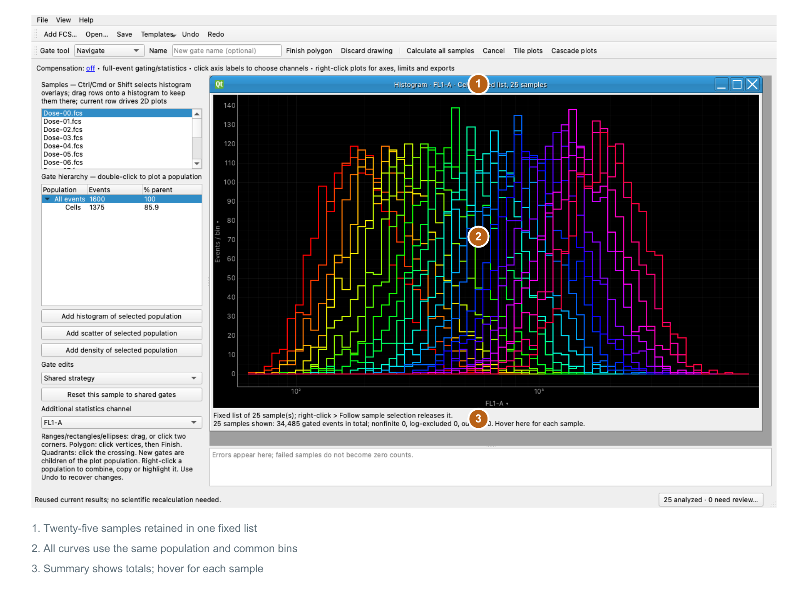

1. Select or drop as many sample rows as needed. This illustration contains 25 separate synthetic samples in one gated histogram; 9, 25 and 100 files are covered by automated tests.
2. Colours and legend numbers identify samples. With many curves, use Show legend to reclaim plot space and use histogram statistics or CSV exports for exact sample identities.
3. Above eight curves, the note below the plot shows totals. Hover over it for the per-sample details. A failed sample is named; it is omitted from curves and bins rather than represented by invented zeros.
4. Use common bins and the intended normalization when comparing shapes. Keep individual full-event statistics for quantitative comparisons; the curves are separate samples, not a pooled acquisition.
5. The bounded Mac test used 100 files x 5,000 events, file compensation and a logicle axis. All 100 gated counts and medians matched NumPy. Drop-to-completion took about 2.74 seconds in this offscreen test.

No fixed application cap means no forced truncation. These measurements cover a bounded workload, not infinite hardware capacity.

## 18. Check the acquisition over time
Right-click a sample > Acquisition over time.

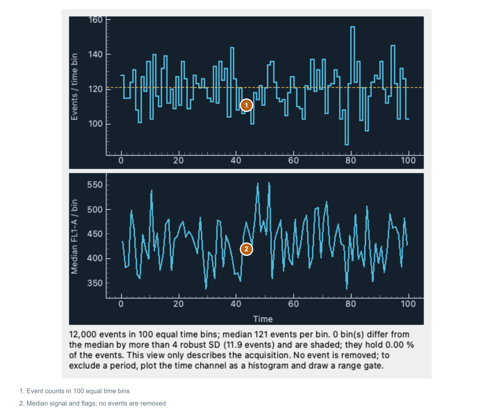

1. The view uses all file events in 100 equal time bins and shows event counts plus median signal for the statistics channel.
2. A bin is flagged when its count differs from the median count by more than four robust standard deviations, with a Poisson floor. The formula is in ANALYSIS_OPTIONS.md.
3. This window flags acquisition irregularities; it removes no events and is not saved. To select a time interval, add a time-channel histogram and draw a range gate.
4. Add singlet gate, in a population's context menu, proposes an area/height polygon based on median height/area ratio +/- 3 robust SD. Inspect it on every sample.

The singlet and time formulas are fixed heuristics. They have not been biologically validated on real acquisitions.

## 19. Export the statistics you need
File > Export > Statistics recalculates independently of the open plots.

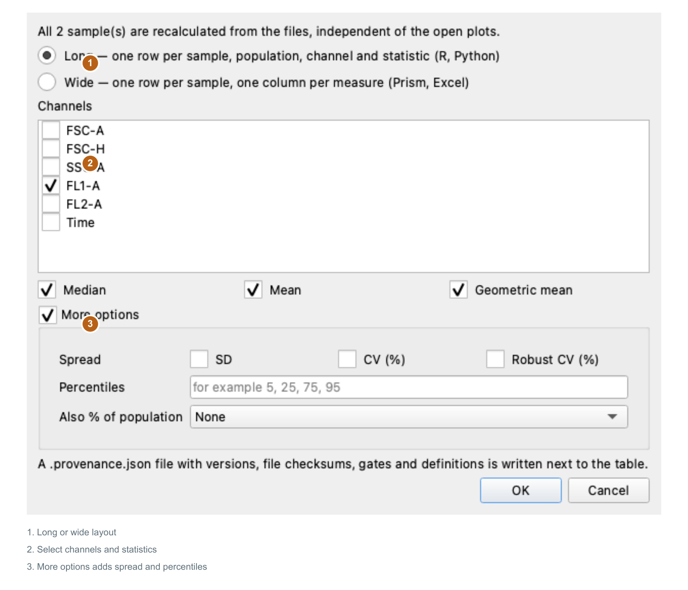

1. Select channels and statistics. Default channels include the statistics channel and open-plot channels. With none selected, export counts and percentages only.
2. Long layout has one row per sample/population/channel/statistic and suits R or Python. Wide layout has one row per sample and suits Prism or Excel.
3. More options enables SD, CV, robust CV, percentiles and percent of a chosen population. Every result uses the full gated population.
4. Keep the adjacent .csv.provenance.json: it records versions, FCS checksums, data domain, gates, compensation, definitions and failed samples.

A failed sample is named and omitted; it is never written as zero. Review error messages and provenance before using an incomplete export.

## 20. Understand values and statuses
The exported status explains why a value is absent.

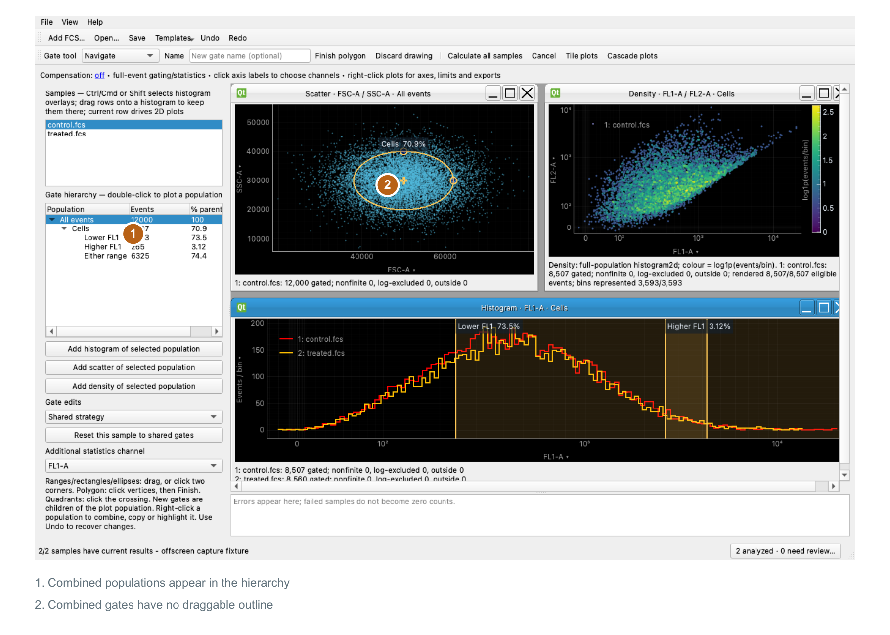

1. Median and arithmetic mean summarize untransformed selected values. Geometric mean is exp(mean(log(x))) and requires every selected value to be positive.
2. SD uses the sample denominator n-1. CV is 100 x SD / mean. Robust CV is 100 x 0.5 x (P84.13-P15.87) / median. Percentiles use linear interpolation.
3. percent_parent and percent_total state their denominator. events_per_ul uses $VOL / 1000 because $VOL is in nanolitres; the measure is absent when no volume exists.
4. empty = no events; nonpositive = geometric mean includes zero/negative values; nonfinite = invalid selected values; insufficient = too few events for SD; undefined = denominator is zero.
5. Range gates use a lower-inclusive, upper-exclusive interval. Legacy histogram-bin edge conventions are distinct: preserve the bin definition when comparing exports.

MFI is ambiguous without a chosen statistic. Record median, arithmetic mean or geometric mean explicitly; do not silently substitute one for another.

## 21. Histogram snapshots and bin export
Right-click the relevant histogram to inspect or export it.

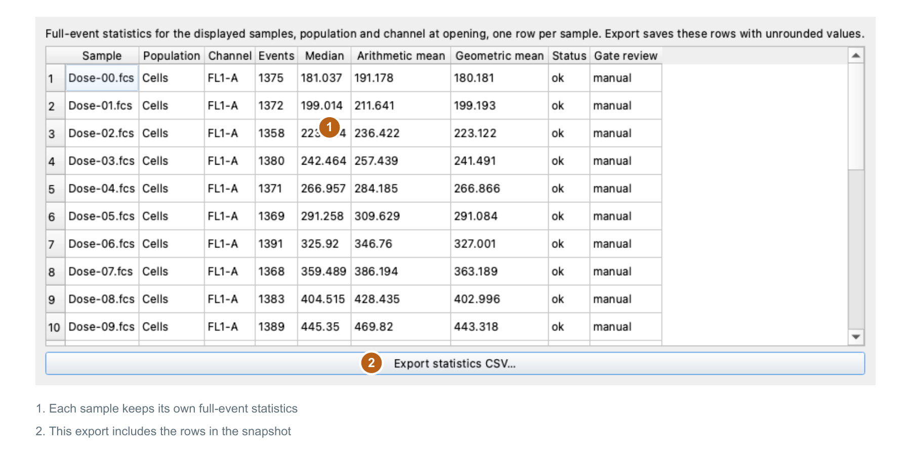

1. Histogram statistics is a snapshot of the displayed samples, population and channel at opening. Each sample is one row with its event count and three columns: median, arithmetic mean and geometric mean. Cells show six significant digits; the tooltip shows the unrounded value. Export statistics CSV writes the same rows with unrounded values.
   An empty cell means that statistic could not be calculated; the Status column gives the reason, for example `geometric_mean: nonpositive` when the population holds values of zero or below.
2. Use the global File > Export > Statistics action for an experiment-wide table; the snapshot has a narrower scope.
3. Export plot data writes histogram bins separately: boundaries in original units, counts and normalized values.
4. Changing count/fraction/peak normalization or offset layout changes the drawing, not full-event statistics. Retain nonpositive, nonfinite and outside-range counts when interpreting a plot.

## 22. Export events, images and methods
Choose output according to what you need to analyse or report.

1. Right-click a scatter plot > Export plot data writes every event of the plotted population and its untransformed x/y values. It does not export only the drawn subset.
2. Density plot data export offers either event values or 2D bin counts. Histogram plot data exports bins rather than event rows.
3. Save plot image exports the current plot. File > Export > Plot images writes the open plots for all or selected samples as PNG, SVG or PDF, on white.
4. File > Export > Methods report produces a Markdown record and draft methods paragraph. Review it for your experiment and keep its file and gate provenance.
5. Image files receive numbered names to preserve existing files. Exported curves and labels should be checked visually before publication.

```text
python -m flowhero export-statistics PROJECT --output table.csv
python -m flowhero methods-report PROJECT --output methods.md
```

Replace PROJECT with your project path. Run commands from the installed FlowHero environment, or use the source launcher with these arguments.

## 23. Annotations and control thresholds
These 0.8.0 tools add experimental context and a reproducible cutoff.

1. File > Import > Sample annotations (CSV) reads a header, an FCS filename column and annotation columns. Comma, semicolon and tab are recognized.
2. Filenames match with or without .fcs and without case sensitivity. Unmatched rows are reported. A repeated import replaces annotations for matching samples.
3. Annotations are saved in projects and included in statistics/methods exports; they are not copied into templates.
4. Right-click a histogram > Set threshold from control. Select a control sample and percentile (default 99). The current plotted population and channel define the input.
5. The threshold becomes an editable shared upward range, with a finite upper bound of 1e12 in original units. It is not recalculated when the control changes.

```text
file,Genotype,Dose_nM
control.fcs,WT,0
treated.fcs,WT,10
```

Only positive values contribute to a log-axis percentile threshold. Record the control, percentile and data domain; inspect the resulting biological selection.

## 24. Save, reopen and relink
A project stores the strategy and references; FCS acquisitions remain separate.

1. Save writes a .flowhero.json project. Legacy .flowpilot.json files still open. New saves use schema 10 and cannot be opened by 0.9.0 or earlier; save a new project copy.
2. Use Save project as for a new analysis copy. Reopen it and recalculate to confirm the result before distributing an export.
3. If an FCS file moved, use Relink sample. Its bytes must match the stored SHA-256; another acquisition with the same filename is rejected.
4. FCS paths in a project must remain resolvable. Do not assume moving the project alone moves its data.
5. FlowHero keeps compatible serialized protocol identifiers for old projects, imports and packages. These internal identifiers are not the displayed product name.

Renaming the product did not convert existing scientific definitions. Existing project files, laboratory inputs and historical test baselines were retained.

## 25. Share a portable package
File > Save portable package bundles the project and active FCS data.

1. Save to a new .flowhero.zip package. Source files are streamed and verified; the original acquisitions remain unchanged.
2. On another computer, File > Open portable package imports into a new local folder and checks inventory, sizes and hashes before publication.
3. Legacy .flowpilot.zip packages remain readable. The internal portable protocol and project schema still carry compatible historical identifiers.
4. Portable packages include active inputs, effective sample geometry and strategy. Historical adaptation reference paths/provenance are retained, but those reference acquisitions are not automatically bundled.
5. Keep the extracted folder together, reopen project.json and recompute. A cancelled or failed package operation must not be treated as a completed share.

Integrity checking detects altered payloads; it does not certify the sender or establish scientific correctness.

## 26. Import a FlowJo workspace
File > Import > Gate definitions accepts supported FlowJo 10 .wsp files.

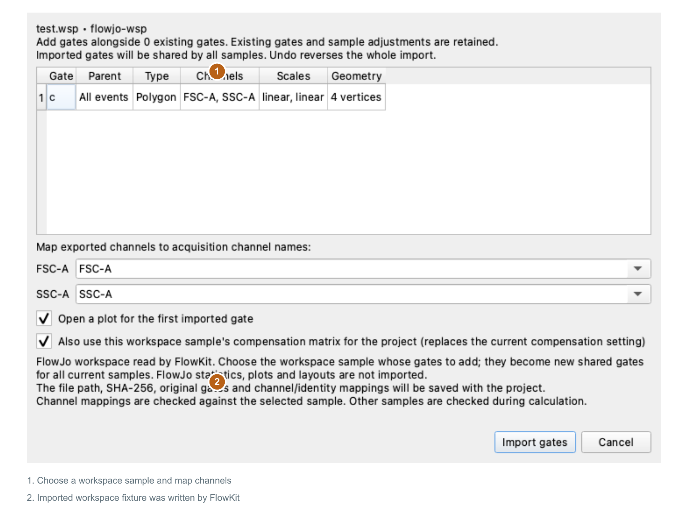

1. Choose the workspace sample whose gate strategy you want. Inspect the channel mapping, hierarchy and preview.
2. Choose whether to take over the workspace compensation matrix. Check all existing fluorescence gates after changing the data domain.
3. FlowJo biex/ArcSinh gate coordinates are converted onto default logicle axes; boundary events may differ. Compare intermediate gate counts with the source analysis.
4. Unsupported gates are named and may be skipped with dependent descendants. Read all import notes before accepting the resulting strategy.

This workflow was tested only with FlowKit-written workspaces. A workspace saved by FlowJo itself has not been tested yet.

## 27. Templates and adaptive proposals
Templates reuse definitions; adaptive proposals require scientific review.

1. Templates saves and applies a named shared gate/plot strategy to compatible samples. Choose the intended population and channels rather than relying on appearance.
2. FlowHero uses a separate settings/templates location. Existing old-name templates can be opened explicitly; copy them into the new template folder if you want them listed.
3. The experimental analyze command uses an explicit reference and new FCS inputs to propose parent-before-child population adjustments with recorded geometry and hashes.
4. Proposals remain provisional. Review original/proposed/current shapes; accept, edit, reset or restore them and inspect descendant populations after parent edits.
5. Adaptive analysis refuses compensated projects and combined gates. It does not establish biological correspondence or automatically justify moving fluorescence thresholds.

```text
python -m flowhero inspect PROJECT
python -m flowhero analyze --help
```

Save the reopened project, exports and adaptation provenance together. Numerically reproducible output is not the same as human acceptance of the gate proposal.

## 28. Recovery and troubleshooting
The operational quality view lists samples with errors or review needs.

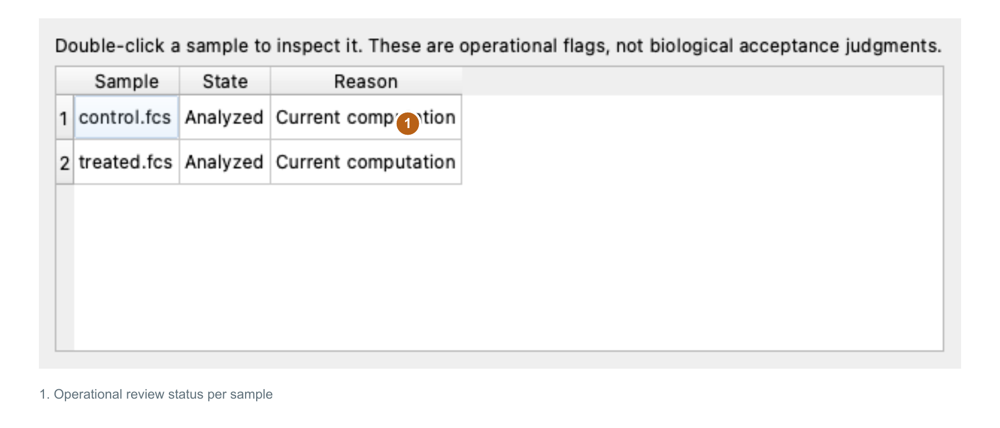

1. Every two minutes, unsaved work is written to a recovery copy in FlowHero settings. After an abnormal end, the next start offers Restore, Discard or Decide later.
2. A restored project is unsaved: use Save project as. Normal Save, opening another project and normal close remove the current recovery copy.
3. Missing channel: choose a valid acquisition channel or correct import mapping. Missing spillover: select Off or supply a valid common matrix and review all affected gates.
4. Moved FCS: relink the original bytes. Pending/cancelled computation: Calculate all samples and inspect the quality list before exporting. If a drop says to wait for calculation, the list was not added: finish calculation and drop again.
5. For a bug report include the version, exact steps, input hashes, gates/scales/compensation, the error text and a small shareable project. Native crashes need the macOS crash report.

A real crash followed by a restart has not been tested systematically. Automated tests cover recovery-copy ownership, selection, restoration and save cleanup.

## 29. Quick reference
Keep this page beside your first experiment.

1. Import: Add FCS; inspect channels and stored metadata. Choose compensation before finalizing fluorescence gates.
2. Gate: confirm the parent in the plot title; select a tool; draw; inspect count and percent of parent. Check Shared strategy versus Selected sample only.
3. Compare: drag rows onto the target histogram to add curves to its fixed list, or use Follow sample selection for automatic overlays. Check legend, common bins, scales and normalization.
4. Quantify: choose a named statistic, use all events, preserve unavailable statuses and inspect failed samples. Export long for R/Python or wide for Prism/Excel.
5. Save: .flowhero.json references data; .flowhero.zip bundles active inputs. Reopen and recompute before sharing.
6. Review: check compensation changes, converted workspace boundaries and every automatic proposal. Real-acquisition validation and native mouse/dialog checks remain open.

No spectral unmixing, compensation estimation from controls, clustering, dimensionality reduction, plate layouts or FlowJo workspace export is provided. This is a development version.
